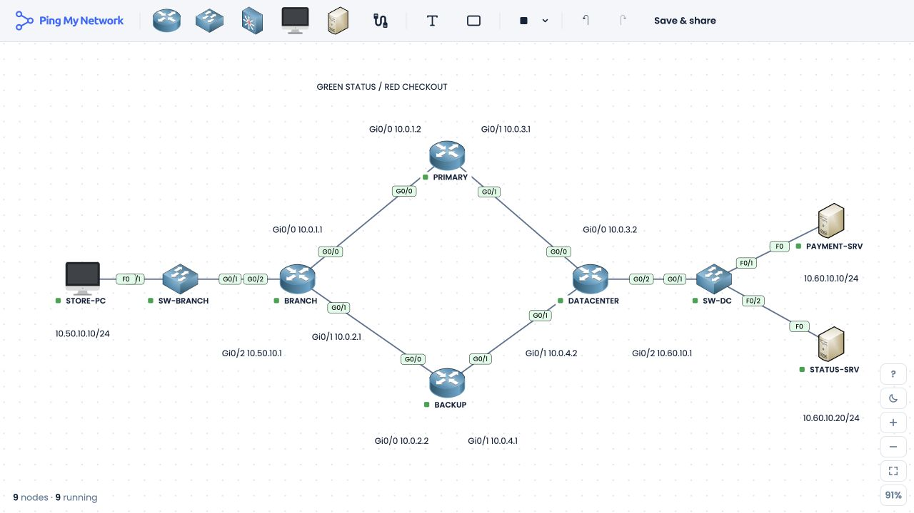

# Green Status, Red Checkout

An OSPF troubleshooting lab built in [PingMyNetwork Sandbox](https://pingmynetwork.com/sandbox). A branch has two paths to its data center. After a link failure, the status host still responds while the payment host becomes unreachable. The exercise is to find out why and recover the payment path with the failed link still down.

I built this to test something a normal “can I ping the data center?” check can miss. Both servers are on the same subnet, and the backup path is working. The interesting part is explaining why the two hosts behave differently.

PAYMENT-SRV and STATUS-SRV represent application endpoints. The lab tests ICMP reachability and routing; it does not run a payment application or validate a checkout transaction.

## Run the lab

1. Open [lab-files/green-status-red-checkout.json](lab-files/green-status-red-checkout.json) and use GitHub's **Download raw file** button.
2. Open [Sandbox](https://pingmynetwork.com/sandbox), select **Save & share → Import JSON**, and choose that file.
3. Import adds the lab to the saved list. Select **Open** beside the imported entry to load it onto the canvas. Use **Show all** if the canvas is off-center.
4. Let OSPF converge. On BRANCH, run `enable`, `show ip ospf neighbor`, and `show ip route`; the two neighbors should be FULL and the `10.60.10.0/24` OSPF route should be present. An immediate ping during startup can fail before those routes appear.
5. Start with [CHALLENGE.md](CHALLENGE.md). Both hosts should respond before the failure is introduced.

No local runtime is needed to import the JSON. Reimporting it restores the starting configuration.



## Topology and addressing

| Device | Interface | Address | Connected to |
| --- | --- | --- | --- |
| STORE-PC | Fa0 | `10.50.10.10/24` | SW-BRANCH; gateway `10.50.10.1` |
| BRANCH | Gi0/0 | `10.0.1.1/30` | PRIMARY Gi0/0 |
| BRANCH | Gi0/1 | `10.0.2.1/30` | BACKUP Gi0/0 |
| BRANCH | Gi0/2 | `10.50.10.1/24` | Branch LAN |
| PRIMARY | Gi0/0 | `10.0.1.2/30` | BRANCH Gi0/0 |
| PRIMARY | Gi0/1 | `10.0.3.1/30` | DATACENTER Gi0/0 |
| BACKUP | Gi0/0 | `10.0.2.2/30` | BRANCH Gi0/1 |
| BACKUP | Gi0/1 | `10.0.4.1/30` | DATACENTER Gi0/1 |
| DATACENTER | Gi0/0 | `10.0.3.2/30` | PRIMARY Gi0/1 |
| DATACENTER | Gi0/1 | `10.0.4.2/30` | BACKUP Gi0/1 |
| DATACENTER | Gi0/2 | `10.60.10.1/24` | Server LAN |
| PAYMENT-SRV | Fa0 | `10.60.10.10/24` | SW-DC; gateway `10.60.10.1` |
| STATUS-SRV | Fa0 | `10.60.10.20/24` | SW-DC; gateway `10.60.10.1` |

SW-BRANCH and SW-DC are Layer 2 switches; they do not need routed addresses for this lab. The four routers are ISR4331 models and the switches are WS-C2960-24TT-L models in Sandbox. OSPF process 1 runs in area 0. Each primary WAN link has cost 10; each backup WAN link has cost 50. The two LAN interfaces are passive in OSPF.

The router command files are in [configs/](configs/). They are the commands used to build the lab, rather than captured `show running-config` output.

| Connection | First port | Second port |
| --- | --- | --- |
| STORE-PC — SW-BRANCH | Fa0 | Fa0/1 |
| SW-BRANCH — BRANCH | Gi0/1 | Gi0/2 |
| BRANCH — PRIMARY | Gi0/0 | Gi0/0 |
| BRANCH — BACKUP | Gi0/1 | Gi0/0 |
| PRIMARY — DATACENTER | Gi0/1 | Gi0/0 |
| BACKUP — DATACENTER | Gi0/1 | Gi0/1 |
| DATACENTER — SW-DC | Gi0/2 | Gi0/1 |
| SW-DC — PAYMENT-SRV | Fa0/1 | Fa0 |
| SW-DC — STATUS-SRV | Fa0/2 | Fa0 |

## Verification

The baseline, failure, and repair were tested in the live Sandbox. These are observed results:

| State | STATUS-SRV | PAYMENT-SRV |
| --- | --- | --- |
| Both WAN paths up | 4/4 replies | 4/4 replies |
| PRIMARY Gi0/1 shut | 4/4 replies | 0/4 replies; TTL expires in transit |
| Routing repair applied, PRIMARY Gi0/1 still shut | 4/4 replies | 4/4 replies |

The [verification record](verification/README.md) contains the command output and screenshots. The [answer key](ANSWER_KEY.md) explains the forwarding decision and the repair. Try the incident brief first if you want to diagnose it yourself.

The JSON retains the original fault condition and starts with all links up. The repaired state is documented rather than saved over the starter lab.

## Rebuild from the configuration files

Node.js 22 or later is needed only to regenerate or check the import file. The scripts use built-in Node modules and have no package dependencies.

```sh
npm run build
npm run check
```

The build reads `configs/` and the local Sandbox templates, then writes `lab-files/green-status-red-checkout.json`. The check verifies the topology, addressing, saved configurations, and agreement between the generated snapshot and its source files. It does not emulate OSPF; live behavior is recorded separately in `verification/`.

## Files

| File | Use |
| --- | --- |
| [lab-files/green-status-red-checkout.json](lab-files/green-status-red-checkout.json) | Importable Sandbox snapshot: nine devices and nine links |
| [CHALLENGE.md](CHALLENGE.md) | Participant-facing incident brief; does not reveal the route to remove |
| [ANSWER_KEY.md](ANSWER_KEY.md) | Commands and expected observations for the facilitator |
| [configs/](configs/) | Router configuration commands |
| [images/topology.jpg](images/topology.jpg) | Labeled topology captured from Sandbox |
| [verification/](verification/) | Live test output and screenshots |
| [scripts/](scripts/) and [templates/](templates/) | Standalone build and validation source |

The main operational lesson is to test the path a user depends on during failover. A successful check to one host says little about a different host whose routing policy may differ.
