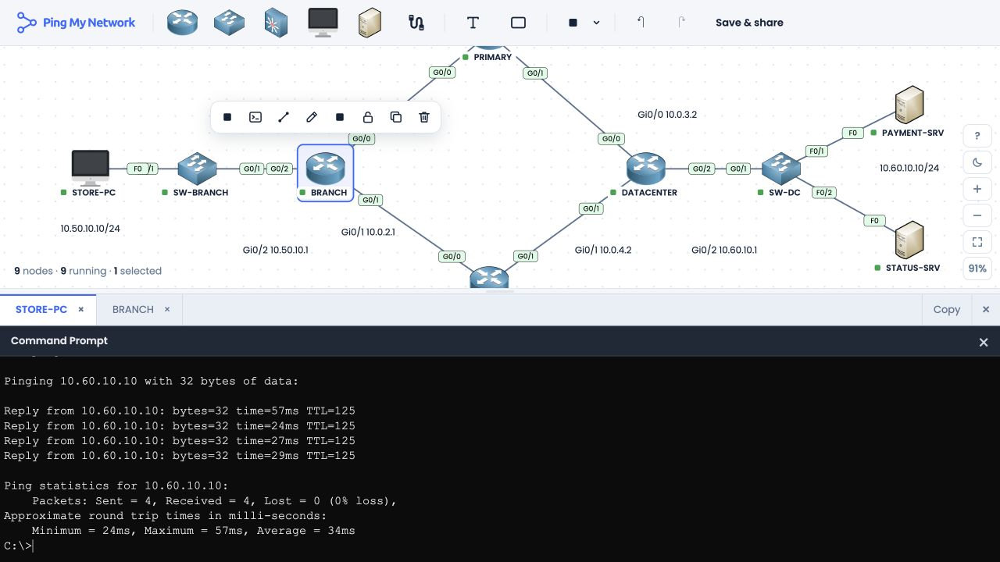
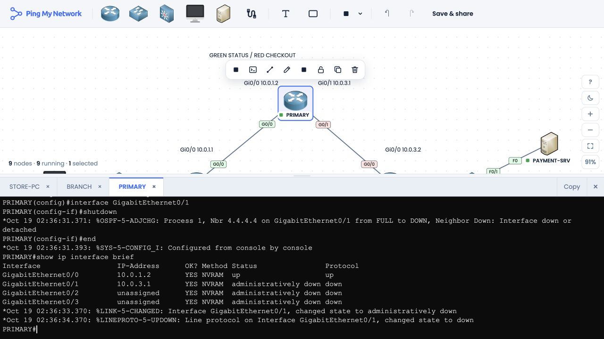
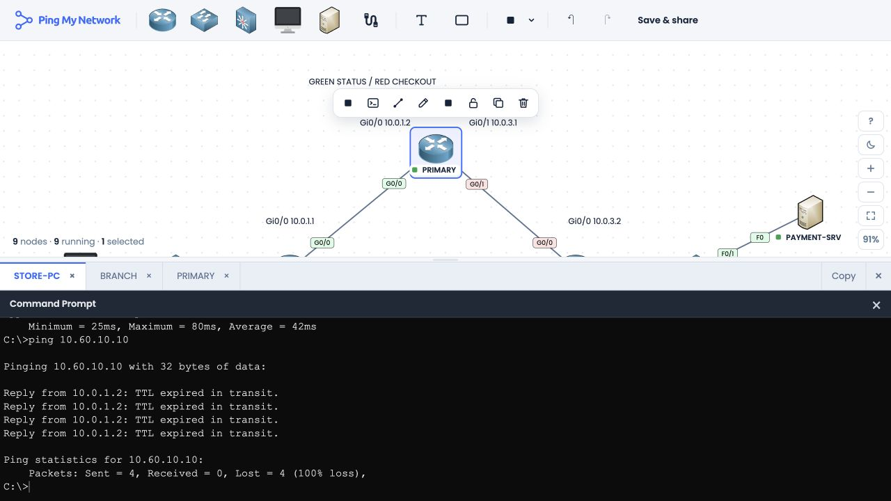
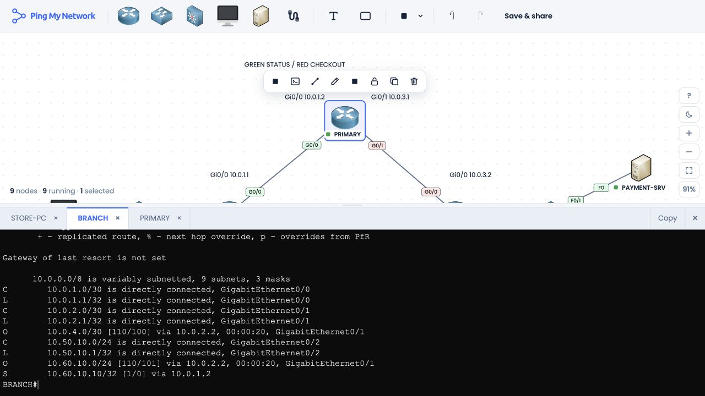
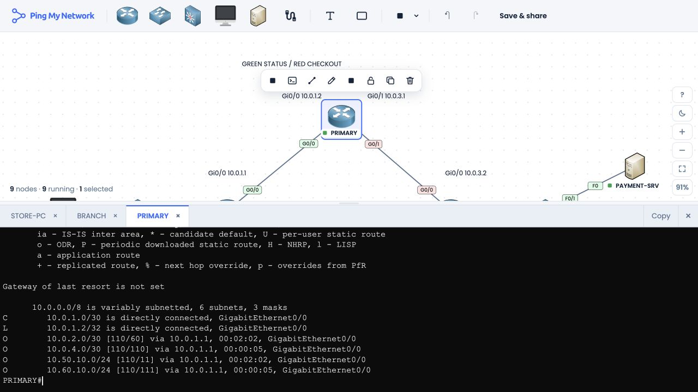
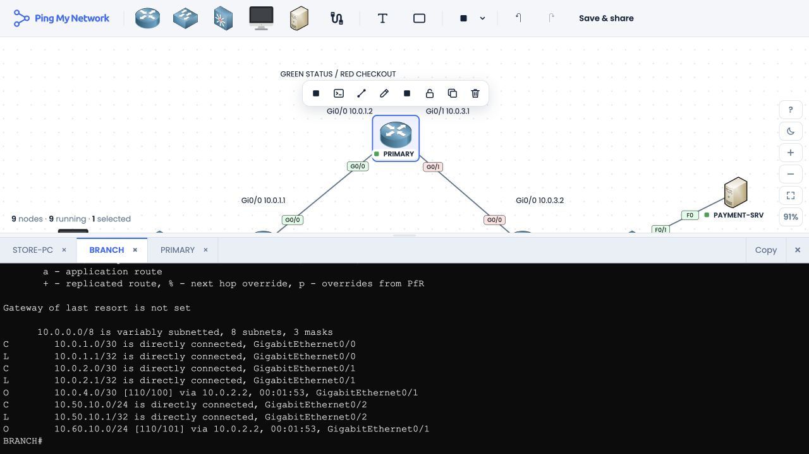
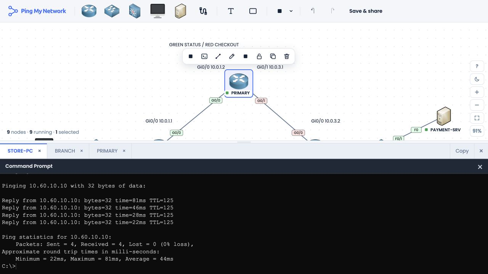
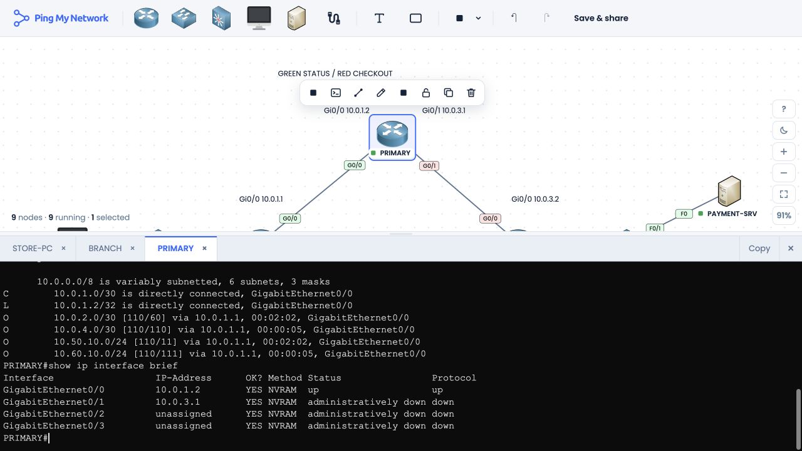

# Live verification record

Tested in PingMyNetwork Sandbox on 18 October 2026 (America/Chicago). Sandbox router log timestamps use the simulator's clock. The screenshots are direct captures of its canvas and console; the text below contains selected command-output excerpts.

The saved starter was opened and OSPF was allowed to converge. An earlier ping immediately after opening the lab returned destination-unreachable responses before the server route appeared. Once BRANCH had the `10.60.10.0/24` route, both baseline tests passed. That startup condition is now included in the lab instructions.

| Phase | Status host | Payment host | Primary data-center interface |
| --- | --- | --- | --- |
| Baseline after convergence | 4/4 replies | 4/4 replies | up/up |
| Link failure | 4/4 replies | 0/4; TTL expires | administratively down/down |
| Host-route repair | 4/4 replies | 4/4 replies | still administratively down/down |

## Baseline

From STORE-PC:

```text
C:\>ping 10.60.10.20
Reply from 10.60.10.20: bytes=32 time=87ms TTL=125
Reply from 10.60.10.20: bytes=32 time=39ms TTL=125
Reply from 10.60.10.20: bytes=32 time=30ms TTL=125
Reply from 10.60.10.20: bytes=32 time=29ms TTL=125
Packets: Sent = 4, Received = 4, Lost = 0 (0% loss)

C:\>ping 10.60.10.10
Reply from 10.60.10.10: bytes=32 time=57ms TTL=125
Reply from 10.60.10.10: bytes=32 time=24ms TTL=125
Reply from 10.60.10.10: bytes=32 time=27ms TTL=125
Reply from 10.60.10.10: bytes=32 time=29ms TTL=125
Packets: Sent = 4, Received = 4, Lost = 0 (0% loss)
```



## Failure

PRIMARY's `GigabitEthernet0/1` was shut from the CLI. The branch-facing interface stayed up:

```text
PRIMARY#show ip interface brief
Interface                  IP-Address      OK? Method Status                Protocol
GigabitEthernet0/0         10.0.1.2        YES NVRAM  up                    up
GigabitEthernet0/1         10.0.3.1        YES NVRAM  administratively down down
```



From STORE-PC after convergence onto the backup path:

```text
C:\>ping 10.60.10.20
Reply from 10.60.10.20: bytes=32 time=80ms TTL=125
Reply from 10.60.10.20: bytes=32 time=25ms TTL=125
Reply from 10.60.10.20: bytes=32 time=32ms TTL=125
Reply from 10.60.10.20: bytes=32 time=31ms TTL=125
Packets: Sent = 4, Received = 4, Lost = 0 (0% loss)

C:\>ping 10.60.10.10
Reply from 10.0.1.2: TTL expired in transit.
Reply from 10.0.1.2: TTL expired in transit.
Reply from 10.0.1.2: TTL expired in transit.
Reply from 10.0.1.2: TTL expired in transit.
Packets: Sent = 4, Received = 0, Lost = 4 (100% loss)
```



The two route tables establish the loop. BRANCH has a valid OSPF backup route to the subnet, but a more-specific static route for the payment host still points to PRIMARY:

```text
BRANCH#show ip route
O        10.60.10.0/24 [110/101] via 10.0.2.2, 00:00:20, GigabitEthernet0/1
S        10.60.10.10/32 [1/0] via 10.0.1.2

PRIMARY#show ip route
O        10.60.10.0/24 [110/111] via 10.0.1.1, 00:00:05, GigabitEthernet0/0
```

PRIMARY's route leads back to BRANCH. Payment packets therefore repeat BRANCH → PRIMARY → BRANCH rather than taking BACKUP.





## Repair with the primary link still down

On BRANCH:

```text
BRANCH#configure terminal
BRANCH(config)#no ip route 10.60.10.10 255.255.255.255 10.0.1.2
BRANCH(config)#end
BRANCH#show ip route
O        10.60.10.0/24 [110/101] via 10.0.2.2, 00:01:53, GigabitEthernet0/1
```

The static `/32` is absent from the repaired table:



From STORE-PC:

```text
C:\>ping 10.60.10.10
Reply from 10.60.10.10: bytes=32 time=81ms TTL=125
Reply from 10.60.10.10: bytes=32 time=46ms TTL=125
Reply from 10.60.10.10: bytes=32 time=28ms TTL=125
Reply from 10.60.10.10: bytes=32 time=22ms TTL=125
Packets: Sent = 4, Received = 4, Lost = 0 (0% loss)

C:\>ping 10.60.10.20
Reply from 10.60.10.20: bytes=32 time=83ms TTL=125
Reply from 10.60.10.20: bytes=32 time=24ms TTL=125
Reply from 10.60.10.20: bytes=32 time=36ms TTL=125
Reply from 10.60.10.20: bytes=32 time=30ms TTL=125
Packets: Sent = 4, Received = 4, Lost = 0 (0% loss)
```



Finally, PRIMARY's interface was checked again. It remained administratively down, confirming that the successful retest did not depend on restoring that link:



Simulator response times are included only as captured output; they are not performance measurements. Successful ping establishes network reachability, not application health. The published starter JSON keeps the original fault and all links up so the exercise can be repeated.
